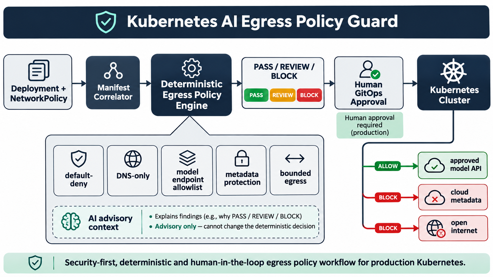

# Kubernetes AI Egress Policy Guard

A deterministic GitOps policy gate for AI workloads that must reach external model APIs without inheriting unrestricted outbound network access. It correlates Deployments, native NetworkPolicies, and Cilium FQDN policies before merge.



## Production problem

Kubernetes allows pod egress by default. A broad allow rule can expose credentials, internal services, and cloud metadata, while a blunt default-deny policy can break DNS and model calls. AI inference services make the problem harder because model providers use DNS names and changing IP ranges. The guard turns those production assumptions into testable policy without allowing AI to widen access.

Demand evidence and sources are recorded in [`docs/research.md`](docs/research.md).

## What it checks

- AI workloads declare reviewed model endpoint domains.
- A namespace-wide default-deny egress baseline exists.
- DNS access is limited to cluster DNS on TCP/UDP 53.
- Native egress rules always bound both destination and port.
- Broad IP rules do not expose AWS-style or Alibaba-style metadata endpoints.
- An FQDN-aware Cilium policy selects each AI workload.
- Declared domains and enforced exact FQDNs match.
- Model endpoint access is limited to TLS on TCP 443.
- Wildcard and undeclared destinations trigger human review.
- Workloads use a dedicated ServiceAccount.

Decisions are deterministic: `PASS`, `REVIEW`, or `BLOCK`. AI is advisory only and cannot add destinations, alter annotations, approve a merge, or deploy.

## Quick start

```bash
python -m venv .venv
source .venv/bin/activate
pip install -e . pytest
pytest
kubernetes-ai-egress-guard samples/compliant.yaml --output json
```

The compliant sample returns a score of 100 and `PASS`.

## Architecture and workflow

1. CI loads the Deployment and egress policy manifests from a pull request.
2. The correlator finds AI workloads and the policies that select them.
3. The deterministic engine checks isolation, DNS, domains, ports, metadata exposure, and identity.
4. CI emits evidence and a `PASS`, `REVIEW`, or `BLOCK` decision.
5. Optional AI translates findings into an explanation or minimal patch draft.
6. A human reviews the change before GitOps reconciliation reaches the cluster.

## Validation

The unit suite covers the compliant path plus missing domains, default ServiceAccount use, missing default deny, unbounded destinations and ports, metadata exposure, missing DNS, wildcard FQDNs, non-TLS model traffic, missing FQDN policy, and undeclared endpoints. GitHub Actions installs the package, runs the tests, and executes the compliant sample.

## Safe deployment

Start in report-only mode, inventory live flows, baseline existing workloads, validate the CNI, exercise staging canaries, and protect policy changes with ownership and expiry. The tool never connects to a cluster. Full security, privacy, operational, and failure-mode guidance is in [`docs/deployment.md`](docs/deployment.md).

## Measurable outcomes

Measure coverage of default-deny and exact endpoint policy, broad-egress exceptions, metadata findings, false-positive rate, remediation time, policy-caused inference failures, and unsafe-change rollback time.

## Trade-offs

- Exact FQDN allowlists reduce exposure but require maintenance when providers add regional endpoints.
- Wildcards reduce operational friction but widen the trust boundary.
- Static analysis is fast and reproducible, but runtime flow validation is still necessary.
- A dedicated CNI feature provides DNS-aware policy but increases platform coupling.
- Human approval slows emergency changes, but keeps production authority auditable.

## Interview positioning

This project demonstrates Kubernetes networking, CNI-aware security design, GitOps policy-as-code, cloud metadata protection, deterministic testing, secure AI boundaries, and production rollout planning. The strongest interview story is how it reconciles a real AI-platform need—dynamic model API access—with least privilege, DNS behavior, failure modes, and measurable operational control.

## License

MIT
