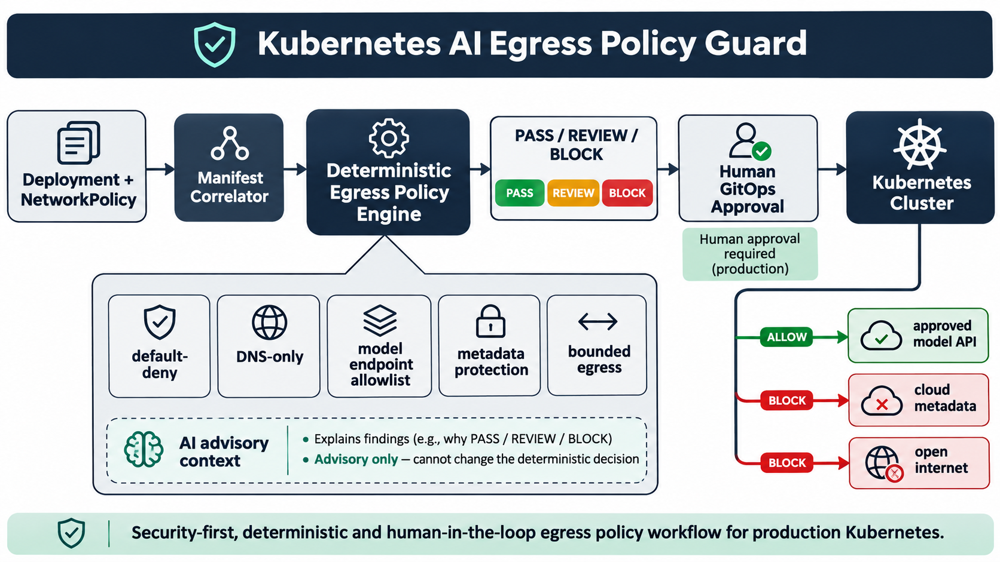

# Governing Kubernetes Egress for AI Workloads Before Production

Imagine an inference service is compromised during a routine model update. The pod can resolve any public domain, reach the open internet, and query a cloud metadata endpoint. The application looked healthy, but the platform never proved that outbound access matched the service's actual needs.

This matters because AI workloads increasingly combine valuable prompts, service credentials, model-provider tokens, and access to internal data. Egress policy therefore affects incident containment, credential exposure, data governance, and the auditability of the production platform.

Kubernetes permits pod egress when no selecting NetworkPolicy restricts it. Native policy is deliberately layer 3/4, while model APIs are usually addressed by DNS names and may change IPs. Teams can easily choose between two bad outcomes: broad outbound access or a default-deny change that breaks DNS and inference.

I built **Kubernetes AI Egress Policy Guard**, a deterministic GitOps gate that correlates workload intent with native NetworkPolicy and Cilium FQDN policy.

- It identifies labeled AI inference Deployments and requires each workload to declare its reviewed model domains and use a dedicated ServiceAccount.
- It verifies a namespace-wide default-deny baseline, then checks that DNS is restored only to cluster DNS on TCP/UDP 53.
- It blocks native rules with missing destinations or ports and detects IP ranges that expose common cloud metadata endpoints.
- It compares declared domains with exact FQDN-aware policy, requires TLS on TCP 443, and sends wildcards or undeclared endpoints to review.
- It emits reproducible `PASS`, `REVIEW`, or `BLOCK` evidence; AI can explain the result or draft a patch, but only a human-approved GitOps merge can reach production.

## Why this is in demand now

Current platform, SRE, cloud-security, and AI-infrastructure roles repeatedly combine Kubernetes, networking, secure automation, multi-tenant isolation, and reliable production operations. Official Kubernetes guidance also recommends default-deny policy and filtering workload access to cloud metadata APIs. The project is grounded in that intersection rather than a generic AI demonstration.

## Implementation and testing

The Python analyzer loads multi-document YAML, correlates selectors and workload labels, evaluates deterministic rules, and returns structured evidence for CI. The test suite covers the compliant path and failure cases for missing isolation, broad access, metadata exposure, DNS, wildcard FQDNs, TLS, and endpoint drift. GitHub Actions runs the suite and the compliant sample on every push and pull request.

## Deployment, security, and reliability

I would introduce the guard in report-only mode, observe real flows, validate the cluster CNI, add default deny, restore required services incrementally, and test model calls and failover in staging. Reports can expose internal resource and destination names, so they need normal operational-data controls. Static policy cannot prove runtime enforcement, TLS identity, DNS integrity, or provider safety; flow observability and canary testing remain necessary.

## Measurable outcomes and trade-offs

Useful measures include default-deny coverage, exact-domain coverage, wildcard exception age, metadata findings, false-positive rate, policy-caused inference failures, remediation time, and rollback time. Exact domains improve containment but require maintenance. FQDN-aware policy adds platform coupling. Human approval adds friction but keeps authority explicit and auditable.

## What this demonstrates in an interview

The project provides a concrete story about Kubernetes networking, CNI behavior, cloud security, GitOps, policy-as-code, testing, failure modes, and secure use of AI. The design choice I would emphasize is the separation between deterministic enforcement and AI-assisted explanation: the model can help an engineer understand the finding, but it cannot silently widen production access.

Repository: https://github.com/ohjeffkuston/kubernetes-ai-egress-policy-guard

This control is game-changing because it turns an ambiguous production trust boundary into evidence that platform, security, and service teams can review together.

How would you balance exact model endpoint controls with the operational reality of provider redirects, regional hosts, and emergency failover?
